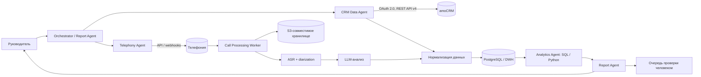

# AI-анализ работы отдела продаж CityCar

Проект автоматизирует запрос руководителя «Проанализируй работу отдела продаж за последние 30 дней»: собирает сделки и задачи из amoCRM, обрабатывает записи звонков, рассчитывает метрики и формирует проверяемый отчёт с рекомендациями. Числовые показатели считаются кодом/SQL; LLM используется для извлечения смыслов из разговоров и объяснения результатов.

## Архитектура



### Компоненты

| Компонент | Назначение |
|---|---|
| **Orchestrator / Report Agent** | Определяет период, запускает пайплайн, контролирует статусы и собирает итоговый отчёт. |
| **CRM Data Agent** | Получает сделки, задачи, пользователей и этапы воронки через amoCRM REST API v4 и OAuth 2.0. |
| **Telephony Agent** | Получает метаданные звонков и временные ссылки/файлы записей через API провайдера телефонии. |
| **Call Processing Worker** | Нормализует аудио, распознаёт речь, разделяет спикеров и сохраняет транскрипт с таймкодами. |
| **LLM Analyzer** | Извлекает потребности, возражения, договорённости, следующий шаг, причины потери и оценку соблюдения скрипта. |
| **Analytics Agent** | Считает метрики кодом/SQL: конверсию, win/loss, скорость прохождения воронки, просроченные задачи и активность менеджеров. |
| **Report Agent** | Формирует краткое резюме, таблицы отклонений, ссылки на первичные данные и рекомендации. |

## Потоки данных

### amoCRM

1. OAuth 2.0 выдаёт access/refresh token; секреты хранятся в Secret Manager.
2. По REST API v4 загружаются сделки (`/api/v4/leads`), задачи (`/api/v4/tasks`), пользователи и воронки.
3. Данные приводятся к общей модели `manager → lead → stage → task → result` и загружаются идемпотентно по ID и `updated_at`.
4. Инкрементальные обновления поступают по расписанию и, где возможно, через webhooks; отчёт строится за заданное 30-дневное окно.

### Телефония и обработка звонков

1. Коннектор получает ID звонка, участников, длительность, направление, время и ссылку на запись.
2. Запись копируется в закрытое объектное хранилище и ставится в очередь обработки.
3. Пайплайн: `audio → очистка/нормализация → ASR → diarization → transcript + timestamps → LLM-анализ`.
4. Звонок связывается со сделкой по ID интеграции, номеру телефона и временному окну; неоднозначные совпадения отправляются на проверку.
5. Каждый вывод содержит ссылку на сделку, запись и фрагмент транскрипта с таймкодом — это позволяет проверить интерпретацию модели.

## Хранение

- **PostgreSQL / DWH:** нормализованные сделки, задачи, звонки, метрики, версии промптов и результаты анализа.
- **S3-совместимое хранилище:** аудио и полные транскрипты; шифрование, ограниченный срок хранения и доступ по ролям.
- **Redis / очередь сообщений:** краткоживущие задания, блокировки, retries и статусы обработки.
- **Журнал аудита:** источник, время получения, версия модели, confidence и ссылки на подтверждающие данные.

## Граница автоматизации

**Система делает сама:** собирает и связывает данные, транскрибирует звонки, считает KPI, находит аномалии и сделки без следующего шага, готовит черновик отчёта и приоритизированный список действий.

**Человеку передаётся:** неоднозначная привязка звонков, низкий confidence, спорная оценка качества, кадровые/дисциплинарные выводы, изменение CRM и коммуникация с клиентом. Решение с существенными последствиями принимает руководитель.

## Три главных риска

1. **Качество и связность данных.** Неполные карточки, дубли, пропущенные задачи и неверная привязка звонка искажают KPI; нужны проверки полноты и очередь исключений.
2. **Ошибки ASR/LLM.** Шум, терминология и неверное разделение спикеров могут привести к ложным выводам; нужны confidence-пороги, цитаты с таймкодами и выборочный контроль.
3. **Безопасность и право на обработку.** Записи содержат персональные данные; необходимы согласия/правовое основание, минимизация данных, шифрование, RBAC, аудит и политика удаления.

## Пример: сделки без активной задачи или с просроченной задачей

Ниже — самодостаточный пример на Python (менее 50 строк). Он проверяет незакрытые сделки, обновлённые за последние 30 дней: `closest_task_at = null` означает отсутствие активной задачи, прошедшее время — просрочку.

```python
import os
import time
import requests

BASE_URL = os.environ["AMOCRM_BASE_URL"].rstrip("/")
TOKEN = os.environ["AMOCRM_ACCESS_TOKEN"]
HEADERS = {"Authorization": f"Bearer {TOKEN}"}
FINAL_STATUSES = {142, 143}  # won / lost


def find_problem_leads() -> list[dict]:
    now = int(time.time())
    page, result = 1, []
    while True:
        params = {
            "limit": 250,
            "page": page,
            "filter[updated_at][from]": now - 30 * 86400,
        }
        response = requests.get(
            f"{BASE_URL}/api/v4/leads",
            headers=HEADERS,
            params=params,
            timeout=30,
        )
        if response.status_code == 204:
            break
        response.raise_for_status()
        payload = response.json()
        for lead in payload.get("_embedded", {}).get("leads", []):
            task_at = lead.get("closest_task_at")
            if lead.get("status_id") in FINAL_STATUSES:
                continue
            if task_at is None or task_at <= now:
                result.append({
                    "id": lead["id"],
                    "name": lead["name"],
                    "reason": "no_active_task" if task_at is None else "overdue",
                    "closest_task_at": task_at,
                })

        if "next" not in payload.get("_links", {}):
            break
        page += 1

    return result


if __name__ == "__main__":
    print(find_problem_leads())
```


## Стек

- **Backend:** Python 3.11+, FastAPI, Pydantic, `requests`/`httpx`.
- **Данные:** PostgreSQL, S3-совместимое хранилище, Redis, SQLAlchemy/Alembic.
- **AI:** Whisper/Deepgram/Yandex SpeechKit для ASR; LLM с JSON Schema для структурированного анализа.
- **Оркестрация:** Celery/RQ для MVP; Temporal/Airflow при росте нагрузки.
- **Наблюдаемость:** OpenTelemetry, Prometheus/Grafana, Sentry.
- **Инфраструктура:** Docker, CI/CD, Secret Manager.


## Реальный AI-проект
[Patent-RAG](https://github.com/AlexeyNeurov/Patent-RAG)

## Документация API

- [amoCRM API v4: сделки](https://www.amocrm.ru/developers/content/crm_platform/leads-api)
- [amoCRM API v4: задачи](https://www.amocrm.ru/developers/content/crm_platform/tasks-api)
- [amoCRM API Reference](https://www.amocrm.ru/developers/content/crm_platform/api-reference)
